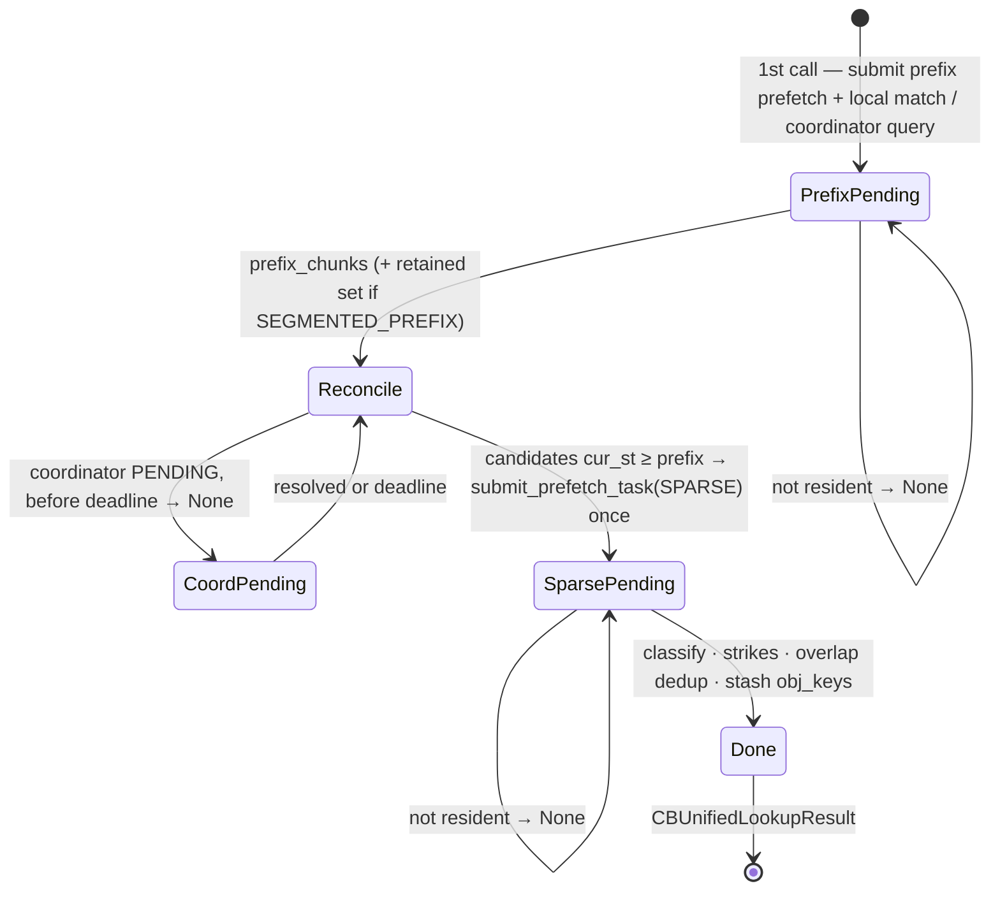

# Blend server (`lmcache/v1/multiprocess/modules/blend/`)

The blend module implements **non-prefix KV reuse** on the LMCache
multiprocess server.

## Package layout

```text
blend/
├── module.py            BlendModuleBase: transfer-neutral state, handshake,
│                        reorder, stash take, applied-range LRU, close;
│                        BlendModule: the LMCache-driven composition
├── engine_driven.py     EngineDrivenBlendModule — COMMIT_STORE shadow +
│                        CB_PREPARE_RETRIEVE / CB_COMMIT_RETRIEVE
├── lookup.py            LookupMixin — CB_UNIFIED_LOOKUP FSM: prefix leg,
│                        local fingerprint match, coordinator leg, sparse leg
├── registration.py      RegistrationMixin — CB_(UN)REGISTER_ROPE (rope
│                        state attach/detach)
├── store.py             FingerprintMixin — fingerprint jobs from a store's
│                        committed-chunk mask + drainers; StoreMixin — the
│                        STORE shadow
├── retrieve.py          RetrieveMixin — CB_RETRIEVE_PRE_COMPUTED: planning
│                        section (invariant specs + flat int64 work tables)
│                        first, then the handler
├── matcher.py           pure: BlendTokenRangeMatcher (fingerprint index)
├── reorder.py           pure: PromptStore + plan() — the CB_REORDER_PLAN
│                        planner (opt-in)
├── rope.py              pure: _CBRopeState, rope geometry rules
└── read_set.py          pure: per-leg object-group read sets and key
                         expansion
```

The pure modules have no server context, streams, or event bus — they are
CPU-testable by import. All mutable state is created in
`BlendModuleBase.__init__` and the concrete module's `__init__`; mixin
methods share it on `self`. The worker half of the engine-driven retrieve
lives in `lmcache/v1/multiprocess/transfer_context/blend_scatter.py`.

## Wire contract

The existing ZMQ request IDs are frozen for compatibility; payload and response
types come from the typed `RequestClient` contract. An incompatible shape
change requires a **new operation name**, never a changed existing contract.

| RPC | Payload → Response | Semantics |
|---|---|---|
| `CB_REGISTER_ROPE` | `(instance_id, cos_sin_ipc[], head_size, is_neox, group_to_cache[], group_rot[][])` → `None` | idempotent; strips baked mscale; MLA must declare its rope window; zero caches = NoPE |
| `CB_UNREGISTER_ROPE` | `(instance_id)` → `None` | KV cache stays registered |
| `CB_UNIFIED_LOOKUP` | `(key, tp_size)` → `CBUnifiedLookupResult \| None` | submit-once / poll-on-recall; `None` = defer, client re-issues |
| `CB_RETRIEVE_PRE_COMPUTED` | `(key, matches[], gpu_block_ids[][], instance_id, event_ipc)` → `(event_ipc, scatter_ran)` | event is server-recorded; may be called more than once per request |
| `CB_PREPARE_RETRIEVE` | `(key, matches[], block_ids[][], instance_id)` → `CBPrepareRetrieveResponse` | engine-driven only; a response with `matches` holds read locks until the commit |
| `CB_COMMIT_RETRIEVE` | `(key, instance_id, scattered)` → `bool` | engine-driven only; releases the locks, records applied ranges if `scattered` |
| `CB_REORDER_PLAN` | `(key, keep_prefix, budget_ms)` → `list[int]` | opt-in (`--enable-blend-reorder`, no coordinator); best-effort: `[]` = keep the prompt (off, no gain, out of budget, any error); else `key.token_ids` reordered, first `keep_prefix` tokens in place; the server never changes a request |
| `CB_PROTOCOL_HANDSHAKE` | `(client_version)` → `(server_version, compatible)` | client-gated by `cb.handshake`, default off |

`STORE` is shadowed: the blend module registers last, so its `store` wraps
`LMCacheDrivenTransfer.store` with fingerprint registration.

## Public API: inputs and outputs

The three data-plane RPCs share one key type: `IPCCacheServerKey` carries
`model_name`, the full `token_ids`, the `[start, end)` token range the call
covers, `request_id` (session tracking), and `worker_id` (TP rank).

**`cb_unified_lookup(key, tp_size) → CBUnifiedLookupResult | None`**

- In: `key` (chunk hashes are computed server-side); `tp_size` — a chunk
  counts as found only when every rank × read-group key is resident.
- Out: `None` while either leg's KV is still loading (client re-polls);
  else `prefix_coverage_tokens` (contiguous prefix coverage in tokens, what
  the standard LOOKUP would report) and `non_prefix_segments` (fingerprint
  matches beyond the prefix, `cur_st` order, each
  `(old_st, old_ed, cur_st, cur_ed, hash)`) — already sparse-prefetched,
  so the retrieve set equals this set.
- Side effects: sparse read locks taken and stashed on the session for the
  retrieve.

**`cb_retrieve_pre_computed(key, matches, gpu_block_ids, instance_id,
event_ipc) → (event_ipc, scatter_ran)`**

- In: `matches` — the lookup's `non_prefix_segments`, any order;
  `gpu_block_ids` — one block table per engine group, indexed by
  `engine_group_id`, possibly partially allocated (vLLM calls once per
  block-alloc round); `event_ipc` — the forward's CUDA event handle.
- Out: a freshly server-recorded scatter-complete event handle plus
  `scatter_ran` per the reason table below — `True` means every matched row
  the client forwards this step is backed by scattered KV, `False` means
  the client degrades the request (TP-consensus).
- Side effects: applied ranges recorded per `(request, worker)`; consumed
  read locks released stream-ordered after the scatter.

**`store(key, instance_id, gpu_block_ids, event_ipc) → (event_ipc,
success)`**

- In/out: identical to `LMCacheDrivenTransfer.store`, which it wraps.
- Side effect (worker 0 only): the stored range's chunk hashes are enqueued
  for fingerprint registration through the device host-func dispatcher
  (`submit_callback_to_stream`, kind `"cb_fingerprints"`) — stream-ordered
  after the L1 commit, so a fingerprint becomes matchable only once its
  chunk is readable. Fingerprint failures are logged, never raised.
- Side effect (reorder enabled, worker 0, a store that committed KV): the
  request's prompt is recorded in the `PromptStore` (below).

## Unified lookup (submit-once, poll-on-recall)

The handler never holds a worker thread across L2→L1 loads: the first call
submits work and returns `None`; each later call polls, returning `None`
until every leg is resident.



The two legs trim opposite ways:

| | Prefix leg (`PREFIX` / `SEGMENTED_PREFIX`) | Non-prefix leg (`SPARSE`) |
|---|---|---|
| Keys | contiguous chunk-hash chain from 0, over `prefix_gids` (attention + recurrent) | matched chunks anywhere, over blend `gids` (attention + aux) |
| Result | leading-ones count via the window-aware fold — truncate at the first gap; `SEGMENTED_PREFIX` additionally retains fully-loaded post-gap chunks (off for recurrent registrations) | keep every chunk whose **entire (read-group × rank) key set** loaded; no contiguity |
| Why | vLLM consumes the prefix as one `num_computed_tokens`; recurrent state needs unbroken history | chunks relocate independently; the forward recomputes the holes |

A chunk missing **any** rank's or **any** read group's key is dropped whole
and takes a stale strike (evicted from the matcher at the strike threshold);
the rest of the request proceeds. The found set's object keys are stashed in
`Session.extras` for the retrieve; whatever no retrieve consumes is released
by the session-destroy listener.

## Retrieve (plan-then-execute, all-or-nothing)

`cb_retrieve_pre_computed` fills temp slots from L1 (H2D), K-only re-RoPEs
the shifted subset, and scatters **per token** into the paged KV — so
non-block-aligned matches and partial vLLM blocks shared with recomputed
tokens are written correctly. The whole request is one flat native plan
(invariant specs cached per GPU context, stamped with the request's slot
mappings; work encoded as numpy int64 tables) enqueued in a single
`cuda_ops` call. There is no fallback path: when the plan cannot be built
the retrieve fails cleanly and the client degrades that request to full
recompute.

The scatter is **all-or-nothing** — never partial. Zero-work returns are
reported with a fixed reason code on `CB_RETRIEVE_NOOP`:

| Reason | `scatter_ran` | When | Client effect |
|---|---|---|---|
| (success) | `True` | every matched range scattered | blend forward proceeds |
| `already_applied` | `True` | repeat call, same destination blocks | no-op by design |
| `matches_beyond_alloc` | `True` (no publish) | **all** matches beyond the allocated slots | defer to vLLM's full-alloc follow-up call; locks stay held |
| `matches_straddle_alloc` | `False` | **some** matches beyond the allocated slots while others are forwarded this step | client degrades the request to full recompute (TP-consensus, no raise) |
| `no_object_keys` | `True` | nothing to read | silent full recompute |
| read/scatter failure | `False` | prefetched objects unavailable, or an exception mid-scatter | client degrades the request |

Invariant: `scatter_ran=True` implies every matched row the client forwards
this step is backed by scattered KV. Every return path exports a **freshly
recorded server event** — echoing the caller's own IPC handle back makes the
worker re-import it (CUDA "invalid device context").

Repeat calls are keyed by the destination blocks each range writes into
(bounded LRU per `(request, worker)`): block-table growth keeps a range
applied, a reassigned destination re-scatters.

## Engine-driven path (`EngineDrivenBlendModule`)

Devices without cross-process device memory and events (CPU, RBLN, and the
other engine-driven backends) cannot take `CB_RETRIEVE_PRE_COMPUTED`: the
server never touches the worker's KV. With `--engine-type blend
--supported-transfer-mode engine_driven` the server composes
`EngineDrivenBlendModule` instead of `BlendModule`. Both share
`BlendModuleBase` — the matcher, `CB_UNIFIED_LOOKUP`, `CB_REORDER_PLAN`, the
handshake, the stash, and the applied-range LRU — so only the transfer half
differs. One module owns the matcher, so `auto` serves blend on one path:
the host device's `DeviceSpec.default_mp_transfer_mode()`, which is also what
its workers resolve `auto` to (engine-driven on RBLN and CPU, LMCache-driven
on CUDA).

| Concern | LMCache-driven (`BlendModule`) | Engine-driven (`EngineDrivenBlendModule`) |
|---|---|---|
| Fingerprint source | `STORE` shadow, enqueue stream-ordered after the L1 commit | `COMMIT_STORE` shadow, enqueue after the synchronous commit |
| Re-RoPE geometry | `CB_REGISTER_ROPE` (cos/sin cache over device IPC) | worker-local `CBRopeSpec`; no RPC |
| Retrieve | one RPC; server runs the CUDA plan | `CB_PREPARE_RETRIEVE` → worker scatter → `CB_COMMIT_RETRIEVE` |
| Completion | server-recorded IPC event | the commit's synchronous return |

```text
worker (EngineDrivenTransferContext.submit_cb_retrieve)          server
  cb_prepare_retrieve(key, matches, block_ids, instance_id) ──▶ sort, applied-range
                                                                filter, alloc gates,
                                                                take stash, unsafe_read,
  ◀── CBPrepareRetrieveResponse(scatter_ran, matches,          export via the instance's
                                data | context["slots"])       SHM / pickle transport
  scatter_cb_matches_to_paged_kv(...)                           (read locks held)
    1. D2H the destination blocks a match covers only partly
    2. host: copy each match's rows, K-only re-RoPE the shifted
    3. H2D the staging chunk as whole blocks
  cb_commit_retrieve(key, instance_id, scattered) ─────────────▶ release 1 lock per key;
  ◀── scattered                                                 record applied ranges
                                                                only if scattered
```

The scatter uses only `DeviceOps.multi_layer_block_kv_transfer`, which
every engine-driven device implements, so no device needs a blend kernel.
The cost is a read-back of the partly covered destination blocks (at most
two per run of adjacent matches) and host-side re-RoPE in fp32
(`torch_ops.pos_kernels`).

Rules carried over unchanged: matches are scattered all-or-nothing, the
`MATCHES_BEYOND_ALLOC` / `MATCHES_STRADDLE_ALLOC` / `ALREADY_APPLIED` /
`NO_OBJECT_KEYS` outcomes keep their wire bools, and a response with no
`matches` holds no locks (the worker sends no commit). A prepared retrieve
whose commit never arrives is released by the next prepare for the same
`(instance, request, worker)`, by `drop_instance_state` when the instance
is reaped, or by `close`. Engine-driven transfer has one KV group, so the
read set is object group 0.

## Reorder planner (`CB_REORDER_PLAN`, opt-in)

With `--enable-blend-reorder` (ignored with a coordinator: a plan sees only
this server's prompts) the server answers `cb_reorder_plan(key, keep_prefix,
budget_ms)` with an order of the prompt `P = key.token_ids` that starts with
an exact copy of the beginning of one cached prompt, so more of `P` is an
exact-prefix hit. The client decides whether to serve it; `keep_prefix` is
the engine's own prefix-cache hit, which stays in place.

**`PromptStore`** (`reorder.py`) holds the token ids of stored prompts:

- Recorded by `store`: a request's first committed store records its token
  ids (the prompt); every store maps the chunk chain hashes it committed to
  the newest prompt that stored them (the owner map).
- Namespaced by `(model_name, world_size, cache_salt)`; `resolve` picks the
  caller's (the salt must be equal; an empty model name / zero world size
  matches any; zero or several matches → no plan).
- LRU-bounded by total tokens (`max_tokens`, 2^24); an evicted prompt leaves
  the owner map, and a namespace goes with its last prompt.
- `candidates` for `P`: the `top_k` (4) prompts owning the most of `P`'s
  fingerprint hits (`BlendTokenRangeMatcher.match_sub_sequence`), the prompt
  holding `P`'s own exact prefix, and the newest prompt; plus the length of
  `P`'s own exact prefix in chunks (the baseline).

**`plan`** (`reorder.py`), per candidate `H`, newest first:

1. Copy the beginning of `H` out of `P`'s own tokens: from each position of
   `H`, take the longest unused run of `P` (≥ `LMIN` = 16 tokens, found
   through a hash index of `P`'s 16-token windows) equal to `H` there; if
   there is none, up to `GLUE` = 3 tokens (a separator) followed by such a
   run. The first `keep_prefix` tokens are the first piece, in place; `P`'s
   last `LMIN` tokens are never moved, so the question stays last.
2. Keep the candidate whose copy covers the most whole chunks, then the most
   tokens, then the fewest pieces.
3. Serve the copy, then the rest of `P` in its original order.

The plan is returned only if it copies more whole chunks than the baseline;
the handler stops at `budget_ms` (a plan finished by then still counts) and
returns `[]` on any error. Token ids only: no document boundaries are needed.

## Locks

Sparse-prefetch read locks follow one rule: exactly one owner releases each
reservation. The retrieve releases applied ranges stream-ordered after the
scatter, releases lookup-stash orphans it will never read, and leaves
beyond-slot-bound ranges locked for the follow-up call; anything never
consumed by a retrieve is released on session destruction.

## Observability

Every `cb.*` span/event is published from the code path it measures:
`CB_REQUEST_*`, `CB_LOOKUP_*`, `CB_PREFIX_LOOKUP_*`,
`CB_FINGERPRINT_MATCH_*`, `CB_COORDINATOR_MATCH_*`, `CB_SPARSE_PREFETCH_*`,
`CB_RETRIEVE_*`, `CB_SCATTER_*`, `CB_RETRIEVE_NOOP`,
`CB_FINGERPRINTS_REGISTERED`, `CB_CHUNKS_EVICTED`. Retrieve/scatter events
stamp `worker_id` so the metrics subscriber can pair START/END per rank at
TP>1. `cb.request` is closed by whichever path finishes the request: the
lookup when there is nothing to retrieve, otherwise the last retrieve.
